<div align="center">

<a href="https://prometheus5863.github.io/prometheus5863/dungeon/"></a>

</div>

<a href="https://prometheus5863.github.io/prometheus5863/dungeon/#room=character"></a>

<a href="https://prometheus5863.github.io/prometheus5863/"></a>

<a href="https://prometheus5863.github.io/prometheus5863/dungeon/#room=war-room"></a>

<p align="center">
<a href="https://prometheus5863.github.io/prometheus5863/dungeon/#room=muse-memory">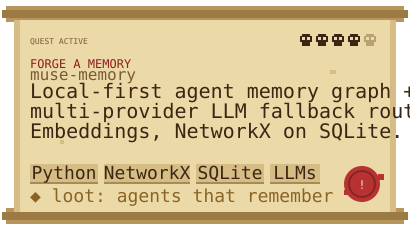</a>
<a href="https://prometheus5863.github.io/prometheus5863/dungeon/#room=invesalius-tep-gsoc2026">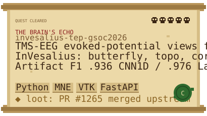</a>
<a href="https://prometheus5863.github.io/prometheus5863/dungeon/#room=quantumtrace">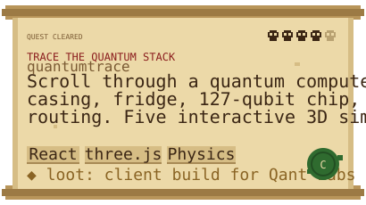</a>
<a href="https://prometheus5863.github.io/prometheus5863/dungeon/#room=downtown-duel">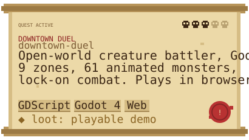</a>
<a href="https://prometheus5863.github.io/prometheus5863/dungeon/#room=single-layer-graphene-structure">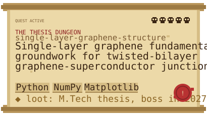</a>
<a href="https://prometheus5863.github.io/prometheus5863/dungeon/#room=design-verification-roadmap">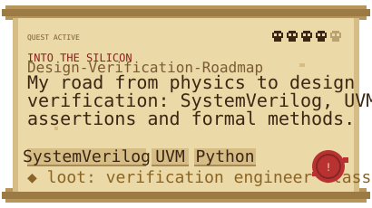</a>
<a href="https://prometheus5863.github.io/prometheus5863/dungeon/#room=form-g-aarsh">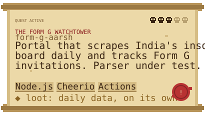</a>
<a href="https://prometheus5863.github.io/prometheus5863/dungeon/#room=triev-whatsapp-crm">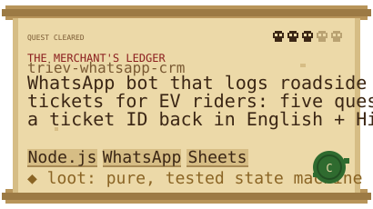</a>
</p>

<p align="center"><sub>⚔️ click a scroll to ride into its room in the castle · or go straight to the code: <a href="https://github.com/prometheus5863/muse-memory">muse-memory</a> · <a href="https://github.com/prometheus5863/invesalius-tep-gsoc2026">invesalius-tep</a> · <a href="https://github.com/prometheus5863/quantumtrace">quantumtrace</a> · <a href="https://github.com/prometheus5863/downtown-duel">downtown-duel</a> · <a href="https://github.com/prometheus5863/single-layer-graphene-structure">graphene</a> · <a href="https://github.com/prometheus5863/Design-Verification-Roadmap">verification-roadmap</a> · <a href="https://github.com/prometheus5863/form-g-aarsh">form-g-aarsh</a> · <a href="https://github.com/prometheus5863/triev-whatsapp-crm">triev-whatsapp-crm</a></sub></p>

<a href="https://prometheus5863.github.io/prometheus5863/dungeon/#room=gallery"></a>

<p align="center">
<a href="https://prometheus5863.github.io/prometheus5863/quantumtrace/">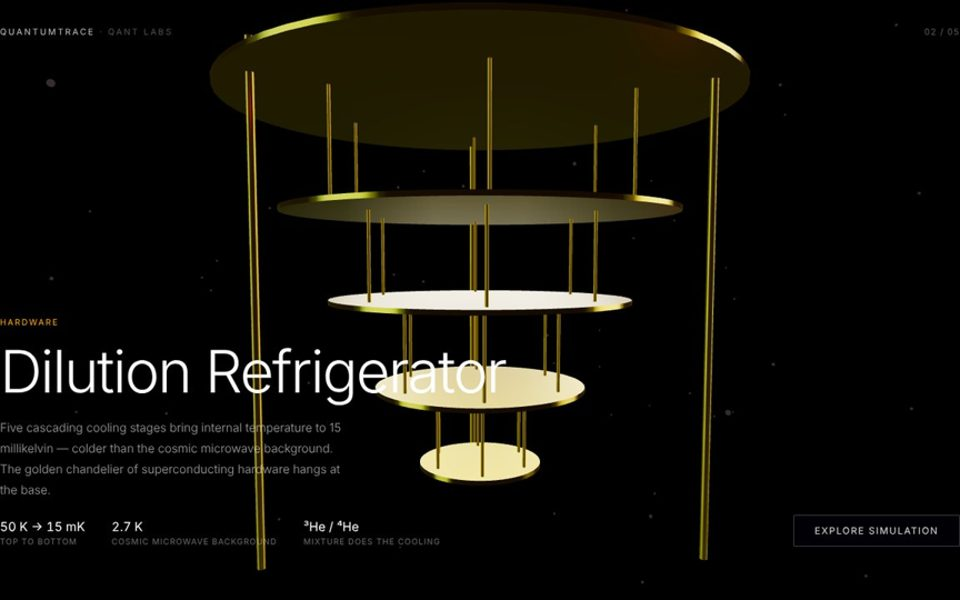</a>
<a href="https://promdom.itch.io/downtown-duel">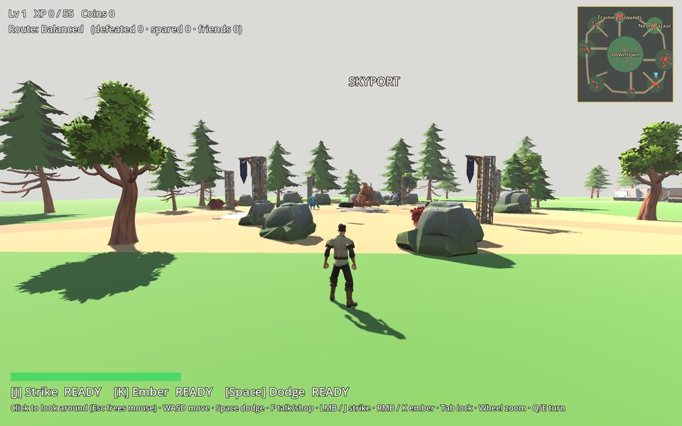</a>
<a href="https://prometheus5863.github.io/prometheus5863/dungeon/#room=operation-cleanslate">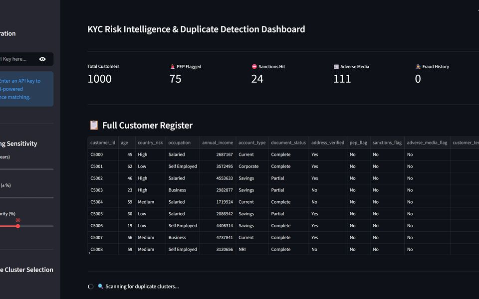</a>
<a href="https://github.com/prometheus5863/form-g-aarsh">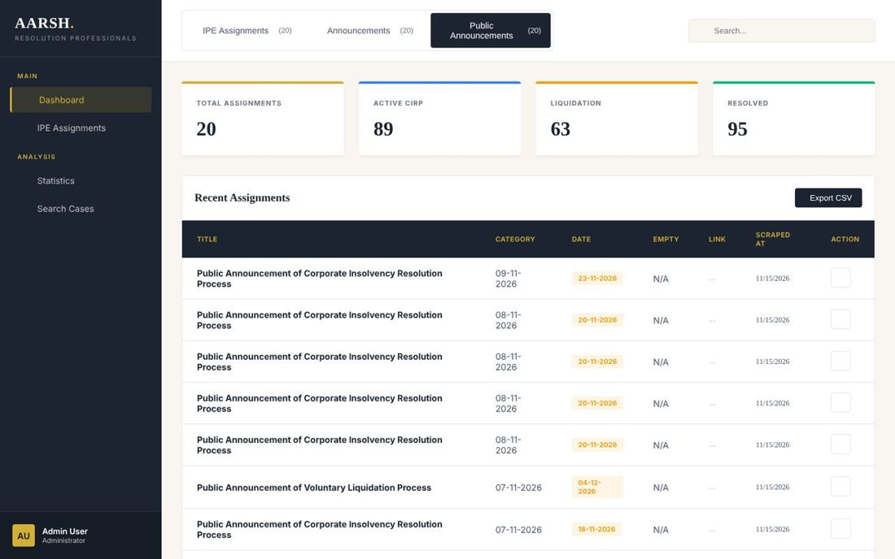</a>
</p>

<p align="center"><sub>🖼️ real screenshots, not mockups: <a href="https://prometheus5863.github.io/prometheus5863/quantumtrace/">QuantumTrace (live)</a> · <a href="https://promdom.itch.io/downtown-duel">Downtown Duel (playable)</a> · Operation Cleanslate · <a href="https://github.com/prometheus5863/form-g-aarsh">Form G portal</a></sub></p>

<a href="https://prometheus5863.github.io/prometheus5863/dungeon/#room=great-hall"></a>

<p align="center">
<a href="https://prometheus5863.github.io/prometheus5863/dungeon/#room=tavern">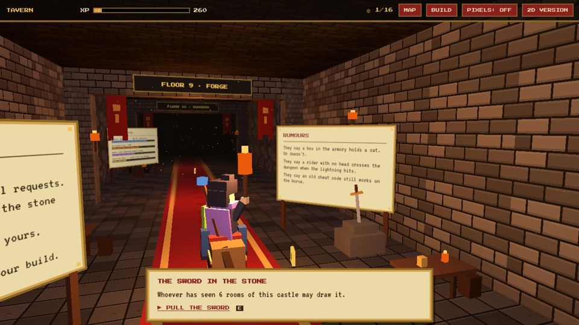</a>
<a href="https://prometheus5863.github.io/prometheus5863/dungeon/#room=character">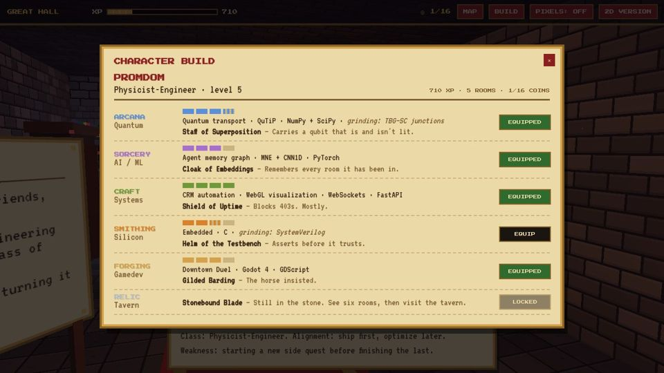</a>
<a href="https://prometheus5863.github.io/prometheus5863/dungeon/#room=kashi">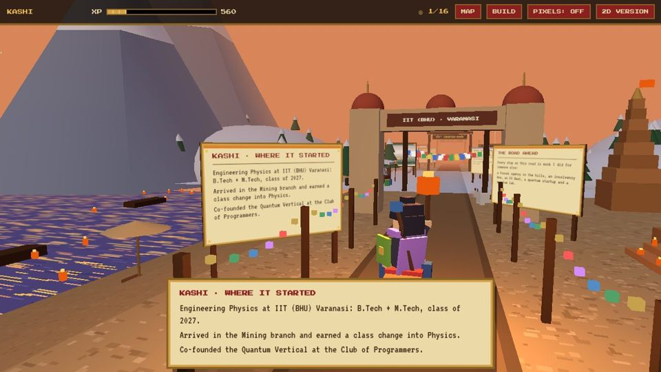</a>
<a href="https://prometheus5863.github.io/prometheus5863/dungeon/#room=gallery">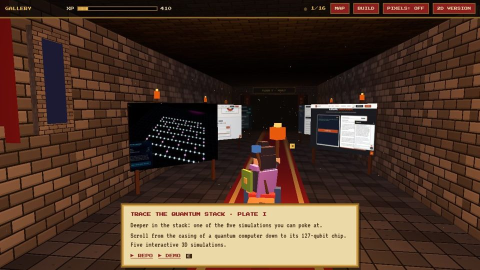</a>
</p>

<div align="center">

| Wing | Ride straight to a room |
| :-- | :-- |
| **The castle** | [Great Hall](https://prometheus5863.github.io/prometheus5863/dungeon/#room=great-hall) · [Library](https://prometheus5863.github.io/prometheus5863/dungeon/#room=library) · [Scribe's Office (résumé)](https://prometheus5863.github.io/prometheus5863/dungeon/#room=resume) · [Armory (skills)](https://prometheus5863.github.io/prometheus5863/dungeon/#room=armory) · [War Room (quests)](https://prometheus5863.github.io/prometheus5863/dungeon/#room=war-room) · [Gallery](https://prometheus5863.github.io/prometheus5863/dungeon/#room=gallery) · [Vault (every other repo)](https://prometheus5863.github.io/prometheus5863/dungeon/#room=vault) · [Tavern](https://prometheus5863.github.io/prometheus5863/dungeon/#room=tavern) · [Forge](https://prometheus5863.github.io/prometheus5863/dungeon/#room=forge) · [Dungeon](https://prometheus5863.github.io/prometheus5863/dungeon/#room=contact) |
| **The road from Kashi** | [Wardrobe](https://prometheus5863.github.io/prometheus5863/dungeon/#room=wardrobe) · [Kashi](https://prometheus5863.github.io/prometheus5863/dungeon/#room=kashi) · [Snow Field](https://prometheus5863.github.io/prometheus5863/dungeon/#room=snow-field) · [Counting House](https://prometheus5863.github.io/prometheus5863/dungeon/#room=counting-house) · [EV Depot](https://prometheus5863.github.io/prometheus5863/dungeon/#room=ev-depot) · [Quantum Chip](https://prometheus5863.github.io/prometheus5863/dungeon/#room=quantum-chip) · [Qant Labs](https://prometheus5863.github.io/prometheus5863/dungeon/#room=qant-labs) |
| **Things to find** | [the character build](https://prometheus5863.github.io/prometheus5863/dungeon/#room=character) · 16 coins · a sword in a stone · a box with a maybe-cat · a jukebox · one rider with no head |

</div>

<sub align="center">Keys: <kbd>W</kbd> <kbd>S</kbd> ride · <kbd>A</kbd> <kbd>D</kbd> steer · <kbd>E</kbd> interact · <kbd>M</kbd> map · <kbd>C</kbd> build · <kbd>Space</kbd> hop</sub>

<a href="https://prometheus5863.github.io/prometheus5863/dungeon/#room=armory"></a>

<a href="https://prometheus5863.github.io/prometheus5863/dungeon/#room=armory">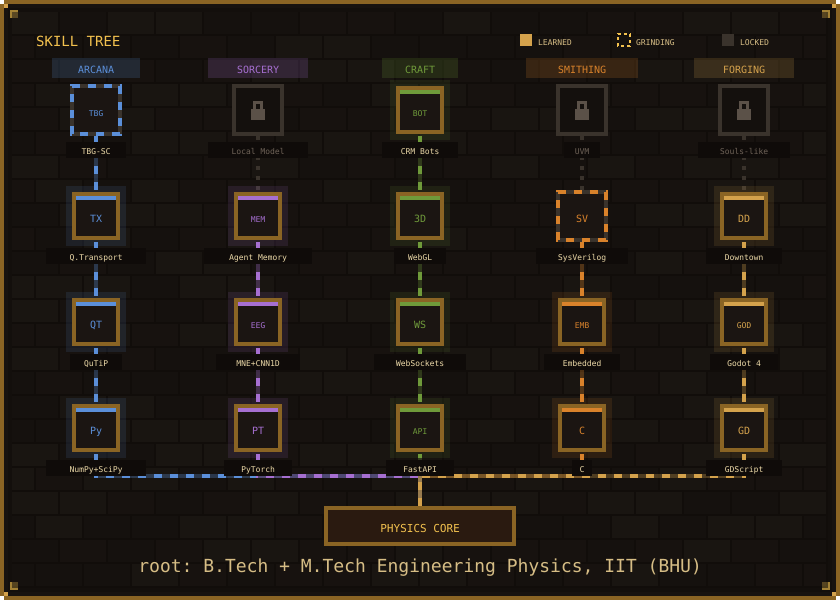</a>


<details>
<summary><b>🧰 Open the loot chest: side quests</b></summary>
<br/>

| Side quest | What dropped |
|---|---|
| [`triev-whatsapp-crm`](https://github.com/prometheus5863/triev-whatsapp-crm) | WhatsApp CRM + lead-gen prototype for a 2W EV fleet |
| [`triev-rsa-backend`](https://github.com/prometheus5863/triev-rsa-backend) | Backend service for an EV startup |
| [`embedded-systems-software`](https://github.com/prometheus5863/embedded-systems-software) | Embedded C drills |
| [`amlc-er`](https://github.com/prometheus5863/amlc-er) | Amazon ML Challenge entry |
| [`ibbi-webscrapper-`](https://github.com/prometheus5863/ibbi-webscrapper-) | IBBI data scraper |
| [`shiv-tour-and-travels`](https://github.com/prometheus5863/shiv-tour-and-travels) | Site for an Uttarakhand travel agency (paid in mountain trips 🏔️) |

</details>

<details>
<summary><b>🏆 Achievements unlocked</b></summary>
<br/>

- 🧠 **Merged upstream:** PR #1265 into InVesalius (open-source neuronavigation)
- 📈 **F1 = 0.976:** LaBraM-based TMS-EEG artifact rejection (CNN1D baseline 0.936)
- ⚛️ **Guild founder:** co-founded the Quantum Vertical at IIT (BHU)'s Club of Programmers
- 🔀 **Class change:** Mining → Engineering Physics
- 🎮 **Shipped to browser:** Downtown Duel

</details>

<details>
<summary><b>🛠️ Equipped gear</b></summary>
<br/>


</details>

<a href="https://prometheus5863.github.io/prometheus5863/dungeon/#room=forge"></a>

```text
[████████░░] thesis: graphene → TBG–superconductor junctions
[██████░░░░] SystemVerilog + UVM  (smithing branch)
[█████░░░░░] muse: a local model that curates its own memory graph
[███░░░░░░░] Downtown Duel → a souls-like for phones
```


<picture>
  <source media="(prefers-color-scheme: dark)" srcset="https://raw.githubusercontent.com/prometheus5863/prometheus5863/output/snake-dark.svg"/>
  
</picture>

<a href="https://prometheus5863.github.io/prometheus5863/dungeon/#room=contact"></a>

<p align="center">
<a href="https://www.linkedin.com/in/harsh-vardhan-gururani-9b35862b5"></a>
<a href="mailto:harshvardhan.gururani.cd.phy22@itbhu.ac.in"></a>
<a href="https://prometheus5863.github.io/prometheus5863/"></a>

</p>
