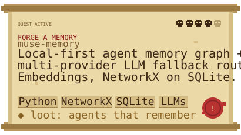
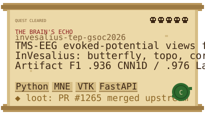
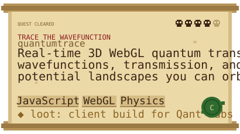
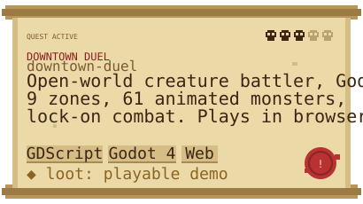
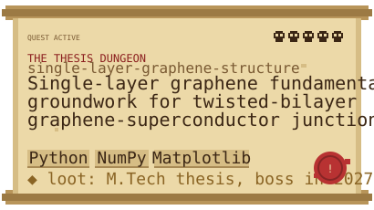
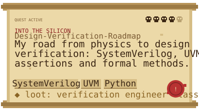
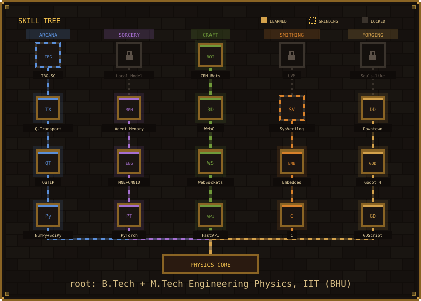

<div align="center">

<a href="https://prometheus5863.github.io/prometheus5863/dungeon/"></a>

</div>



<a href="https://prometheus5863.github.io/prometheus5863/"></a>


<p align="center">
<a href="https://github.com/prometheus5863/muse-memory"></a>
<a href="https://github.com/prometheus5863/invesalius-tep-gsoc2026"></a>
<a href="https://github.com/prometheus5863/quantumtrace"></a>
<a href="https://github.com/prometheus5863/downtown-duel"></a>
<a href="https://github.com/prometheus5863/single-layer-graphene-structure"></a>
<a href="https://github.com/prometheus5863/Design-Verification-Roadmap"></a>
</p>

<p align="center"><sub>⚔️ click a scroll to enter its dungeon</sub></p>





<details>
<summary><b>🧰 Open the loot chest: side quests</b></summary>
<br/>

| Side quest | What dropped |
|---|---|
| [`triev-whatsapp-crm`](https://github.com/prometheus5863/triev-whatsapp-crm) | WhatsApp CRM + lead-gen prototype for a 2W EV fleet |
| [`triev-rsa-backend`](https://github.com/prometheus5863/triev-rsa-backend) | Backend service for an EV startup |
| [`embedded-systems-software`](https://github.com/prometheus5863/embedded-systems-software) | Embedded C drills |
| [`amlc-er`](https://github.com/prometheus5863/amlc-er) | Amazon ML Challenge entry |
| [`ibbi-webscrapper-`](https://github.com/prometheus5863/ibbi-webscrapper-) | IBBI data scraper |
| [`shiv-tour-and-travels`](https://github.com/prometheus5863/shiv-tour-and-travels) | Site for an Uttarakhand travel agency (paid in mountain trips 🏔️) |

</details>

<details>
<summary><b>🏆 Achievements unlocked</b></summary>
<br/>

- 🧠 **Merged upstream:** PR #1265 into InVesalius (open-source neuronavigation)
- 📈 **F1 = 0.976:** LaBraM-based TMS-EEG artifact rejection (CNN1D baseline 0.936)
- ⚛️ **Guild founder:** co-founded the Quantum Vertical at IIT (BHU)'s Club of Programmers
- 🔀 **Class change:** Mining → Engineering Physics
- 🎮 **Shipped to browser:** Downtown Duel

</details>

<details>
<summary><b>🛠️ Equipped gear</b></summary>
<br/>


</details>


```text
[████████░░] thesis: graphene → TBG–superconductor junctions
[██████░░░░] SystemVerilog + UVM  (smithing branch)
[█████░░░░░] muse: a local model that curates its own memory graph
[███░░░░░░░] Downtown Duel → a souls-like for phones
```


<picture>
  <source media="(prefers-color-scheme: dark)" srcset="https://raw.githubusercontent.com/prometheus5863/prometheus5863/output/snake-dark.svg"/>
  
</picture>


<p align="center">
<a href="https://www.linkedin.com/in/harsh-vardhan-gururani-9b35862b5"></a>
<a href="mailto:harshvardhan.gururani.cd.phy22@itbhu.ac.in"></a>
<a href="https://prometheus5863.github.io/prometheus5863/"></a>

</p>
